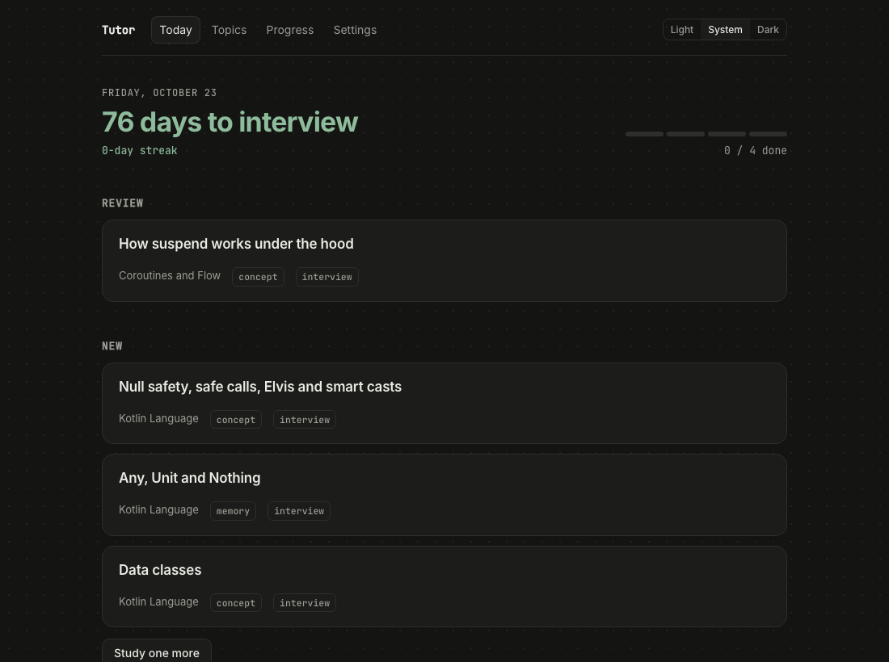
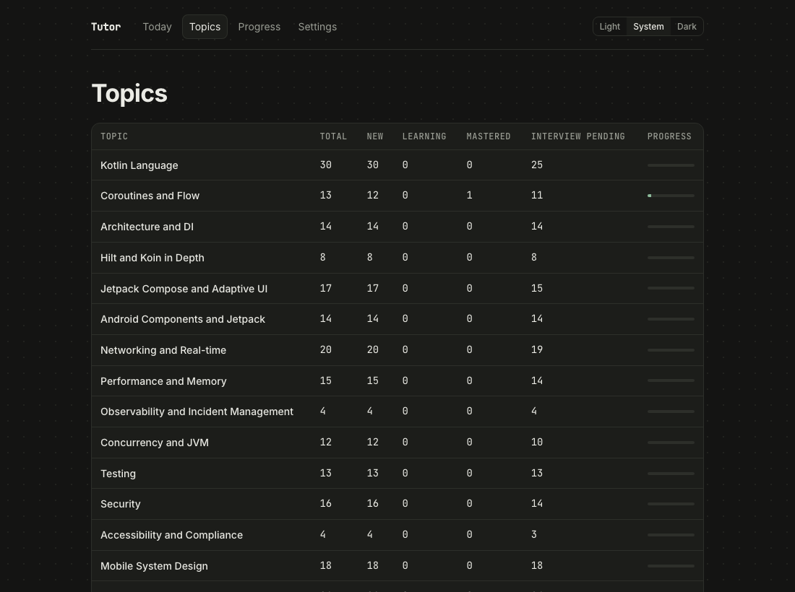
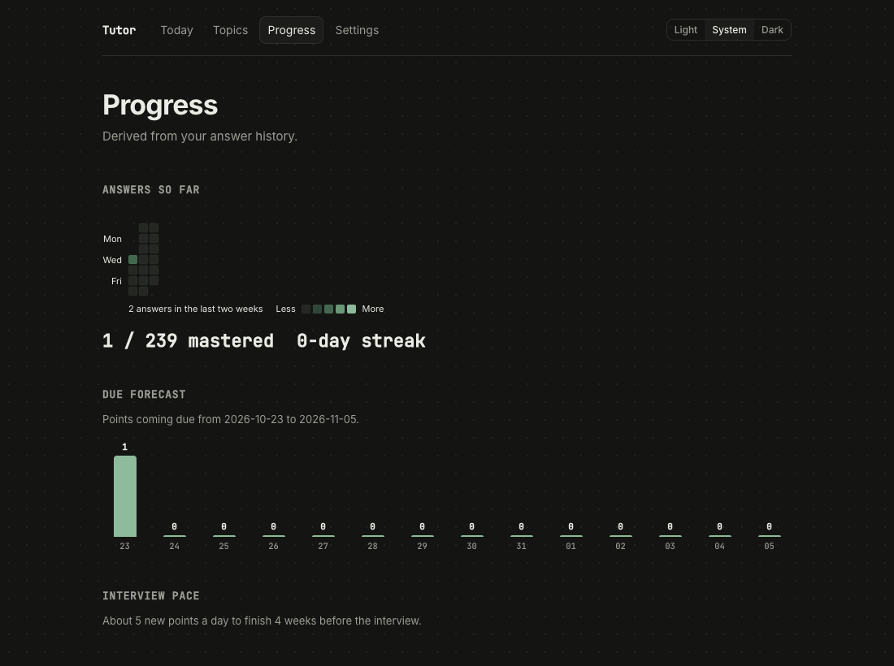

# tutor-learner

**A local study app for interview prep: learn from your own Obsidian notes, answer in your own words, and let Claude
grade you, with spaced repetition that counts down to the interview day.**

A quiet, local web app for studying the **Tutor** points in an Obsidian vault. You answer questions in the browser,
Claude Code grades them on your Mac, and the score is written to the vault by `tutor.py record`. Obsidian's
`Tutor/Dashboard.md` and this app always show the same status.

No account and no API key. Grading runs `claude -p` with your Claude Pro login, so every grade counts against your
plan's usage, the same as a chat message.

| Today | Topics | Progress |
|---|---|---|
|  |  |  |

## What you need

This app is the web front end of an Obsidian **Tutor** setup. It does not create study material by itself. The vault
must already have:

- `Tutor/Points/<Topic>/<NN Name>.md`: one note per knowledge point. The frontmatter has `tutor: point`, `topic`,
  `type` (`memory` | `procedure` | `concept`), `interview`, `order`, `sources` (wikilinks to your notes), and the
  fields `status`, `mastery`, `box`, `next_review` and `history`, which only `tutor.py` writes. The body has
  `**Question:**` and `**Scope:**` lines.
- `Tutor/config.md` (`interview_date`, `interview_buffer_days`, `threshold`, `daily_review_cap`) and
  `Tutor/Roadmap.md` (`topic_order`).
- `.claude/skills/tutor/scripts/tutor.py`: the scorer and scheduler (standard-library Python, no network).

Topics and points are created in the terminal with the Claude Code `tutor` skill. This app only studies them.

## What it does

- **Today:** the reviews that are due (in `tutor.py` order, up to `daily_review_cap`), then the next new points (3 a day
  by default). The list is locked for the day. A countdown shows the days left until the interview, plus your streak.
  "Study one more" adds an optional item.
- **Study:** a new point goes through four steps: a short **pretest** (not scored), a **lesson** written from the point's
  source notes and saved to `Tutor/Lessons/`, the **main question**, then the **result**. A due point skips the
  first two steps. Multiple-choice answers are graded in code. Written answers are graded by Claude against criteria
  fixed when the question was made.
- **English feedback:** for a written answer, you see your text, a corrected version and up to 3 short notes. It is kept
  apart from the score and can be turned off in Settings.
- **Fair grading:** a failed written answer waits until you press "Continue" or "I think this is right". The second
  button gives one regrade with your argument. Each answer adds exactly one line to the point's `history`.
- **Nothing is lost:** your answer is saved before grading. If Claude times out or hits the usage limit, or the server
  restarts, the answer stays and the Study page offers "Grade again".
- **Reading:** a reading list built from the rest of your vault. Each note is classified once by Claude (about 10 notes
  per call) under a Roadmap topic, with a priority, a reading time and a one-line reason. "Up next" suggests 3 notes
  from the topics you are studying today first. Read the note on the page (images from the vault included), then
  answer 3 short questions. Passing 2 of 3 schedules a recheck after 7 days, then after 21 days, then the note is done.
  Failing asks for a reread in 2 days. Due notes show up in Today under "Reading review" (3 a day by default). Reading
  never writes to the vault: its data lives in `state.json`.
- **Topics, Point, Progress, Settings:** status per topic, a point's history and past answers, a heatmap, a 14-day
  due forecast and the pace needed before the interview.

## How it works

```
Obsidian vault ── Tutor/Points/*.md ◀── tutor.py record (only writer of scores)
      │                                      ▲
      │  tutor.py export / due / next        │
      ▼                                      │
 Node server  /api/*  ──── claude -p (lesson, questions, grading) ── your Claude Pro login
      │
      ├── Tutor/Lessons/*.md (lessons, written into the vault)
      └── state.json (question banks, answers, locked Today list, settings) in the app data folder
      ▲
 React UI (Today · Study · Topics · Progress · Settings)
```

- Scores, mastery and the review schedule are computed only by `tutor.py`, from `history`. The app never edits them.
- `claude` runs with no tools, no vault settings and no saved session. The server reads the source notes itself and
  puts them in the prompt. Timeout 90 s, up to 3 retries (2 s, 6 s, 18 s), and no retry on a usage-limit or
  not-logged-in error.
- The server listens on `127.0.0.1` only, sends no CORS headers, and accepts a `POST` only from its own page (`Origin`
  check). In the vault it writes only under `Tutor/Lessons/`.

## Getting started

Requirements: Node 22+, `python3`, and Claude Code at `~/.local/bin/claude`, logged in.

1. Point the app at the vault in `tutor.config.json`:

   ```json
   {
     "vault": "/Users/khue/Obsidian/Khue Vault",
     "claudeBin": "~/.local/bin/claude",
     "timezone": "Asia/Ho_Chi_Minh"
   }
   ```

2. Install and run:

   ```bash
   npm install
   npm run dev      # http://127.0.0.1:5175, app data in ./.data
   ```

   Set `TUTOR_NO_PREFETCH=1` to stop the server from preparing lessons and questions in the background.

## Stable copy that starts at login (macOS)

Like algorithm-learner, a **stable** copy runs next to the development one. It is built from a committed ref into
`~/stable/tutor-learner` and served at `http://localhost:4175`, with its data in
`~/Library/Application Support/tutor-learner` and daily backups. A LaunchAgent starts it at login and restarts it if it
crashes.

```bash
npm run stable:build      # build the current commit into ~/stable/tutor-learner
npm run stable:start      # try it in the foreground
npm run -s stable:launchd > ~/Library/LaunchAgents/vn.khue.tutor-learner.plist   # then launchctl bootstrap, see the guide
npm run stable:update     # rebuild and restart after you commit changes
```

Setup, updates and restoring a backup: [docs/stable-deploy.md](docs/stable-deploy.md).

## Development

```bash
npm test           # vitest: server (real tutor.py on temp vaults, fake claude), logic and UI
npm run typecheck  # tsc --noEmit
```

Tests never touch the real vault and never call the real `claude`.

| Path | Contents |
|---|---|
| `server/tutor.ts` | runs `tutor.py`, one `record` at a time |
| `server/claude.ts` | runs `claude -p`, timeout, retries, error kinds |
| `server/prompts.ts` | prompts and JSON schemas for lessons, question banks and grading |
| `server/study.ts` | the study flow: lessons, banks, answers, grading, recording, prefetch |
| `server/vault.ts`, `server/roadmap.ts` | wikilinks, point text, lesson files, `topic_order` |
| `server/reading/` | Reading tab: catalog scan, classification and quiz prompts, service, vault images |
| `server/state.ts`, `server/backups.ts` | `state.json` (atomic writes) and daily backups |
| `server/api.ts`, `server/plugin.ts`, `server/main.ts` | `/api/*`, the Vite plugin (dev), the stable server |
| `src/lib/` | Today list, stats, dates, shared types |
| `src/pages/`, `src/components/` | React UI |
| `docs/superpowers/` | design spec and implementation plan |

Stack: Vite 5, React 18, TypeScript, Tailwind, react-router, react-activity-calendar, vitest.
